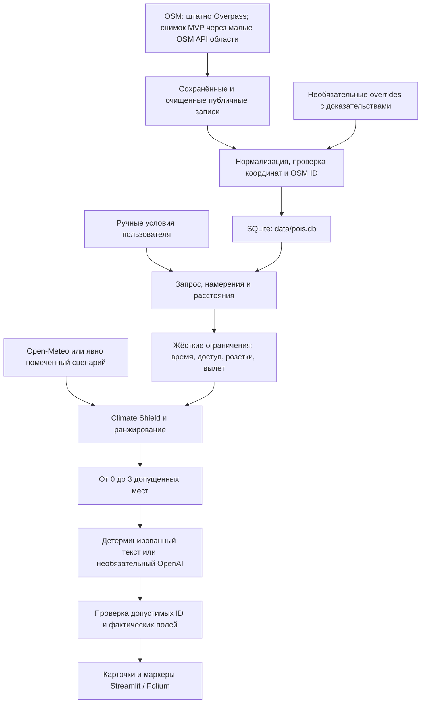

# Архитектура QalaGo

QalaGo использует структурированный RAG: данные сначала извлекаются и проверяются программно, затем поясняются шаблоном или необязательной моделью. Векторной базы и эмбеддингов нет: у многих OSM-записей мало текста, а категории, расстояние и ограничения дают проверяемый путь отбора.

## Границы модулей

- `ingestion/` выполняет отдельную команду загрузки. Успешные исходные ответы остаются в исключённом из Git `data/raw/`. Штатная загрузка использует две области Overpass; подлинный поставляемый снимок получен через четыре малых OSM API области после неудачных попыток Overpass, поэтому покрытие ограничено. Очищенные публичные записи и метаданные распространяются в `data/snapshots/`; `--offline` по умолчанию повторно строит базу из них. `--raw-dir` позволяет выбрать другой сохранённый источник. Стабильные ключи `osm:node:…`, `osm:way:…`, `osm:relation:…` обеспечивают повторяемость. Во время запуска UI и подбора Overpass не вызывается.
- `config.py` содержит приблизительные публичные точки старта и часовой пояс `Asia/Almaty`. Это не сохранённые координаты пользователей.
- `core/models.py` задаёт единый контракт dataclass: `RecommendRequest` → `RecommendResponse`. `core/recommend.py` координирует подбор; UI не формирует список мест самостоятельно.
- `core/geo.py` считает Haversine и оценку ходьбы: `distance_km × 1.3 / 4.5 × 60`. Это эвристика без дорожной сети, переходов и барьеров.
- `core/retrieval.py` сопоставляет категории и ключевые слова, получает реальные SQLite-записи и применяет ограничения. Розетки и Wi-Fi требуют подтверждённого значения, доступность для коляски — явного `wheelchair=yes`, без обещания подходящего маршрута. `unusual` — самостоятельное широкое культурное намерение. Прямые совпадения отделяются от других категорий в `response.alternatives`; суммарно не более трёх мест.
- `core/opening_hours.py` целиком разбирает ограниченное подмножество недельного расписания: дни, интервалы, ночной переход, `24/7`, `off` и замещения через `;`. Выбранный момент, прибытие и полное посещение должны укладываться в указанные часы. Сложные выражения целиком остаются `unknown`; решения `listed_open` и `listed_closed` вычисляются на запрос, не хранятся в БД. Живое открытие не подтверждается. Полная грамматика и ограничения — в `OPENING_HOURS.md`.
- `core/weather.py` отделяет текущие условия Open-Meteo от сценариев `clear`, `wind`, `rain`, `cold`. Ошибка текущей погоды означает `unknown`. Симуляция часов задаётся независимо и не превращает расписание OSM в доказательство «открыто сейчас».
- `core/ranking.py` применяет объяснимую эвристику. При включённом Climate Shield неблагоприятная погода влияет на допуск и приоритеты. Пороговые значения — решения прототипа, не официальные предупреждения.
- `core/llm.py` — необязательный слой коротких пояснений. Нет ключа, ошибка сервиса или некорректный ответ → шаблон для тех же допущенных мест. Модель не управляет названием, координатами, временем и источником карточки.
- `core/comparison.py` один раз получает погоду и фиксирует время, затем вызывает существующий `recommend` с Shield OFF и ON. Исходная метка реальных/симулированных часов сохраняется. Пояснения в сравнении шаблонные; пустой результат не считается нулевым временем на улице. При одинаковых данных улучшение не обещается.
- `core/links.py` строит URL поиска 2ГИС по названию и Астане. Данные каталога 2ГИС не собираются и не сохраняются.
- `app.py` загружает конфигурацию и передаёт отображение в `ui/interface.py`. UI читает реальную статистику SQLite, собирает запрос и показывает ответ backend. Четыре быстрых сценария меняют реальные виджеты и выполняют новый расчёт; ответов-заготовок нет. Подробные и повторяющиеся предупреждения доступны в раскрываемых разделах, краткая неопределённость видна у каждой карточки. Ключи читаются из локального `.env`, окружения или необязательных Streamlit secrets; секреты не помещаются в кэш или карточки.
- `scripts/verify_live_llm.py` — явная команда одного платного LLM-подбора при наличии ключа. Успех фиксируется только при валидированном режиме `llm`; отсутствие ключа и fallback не считаются успешным live-вызовом. Отчёт не содержит ключей, prompt или пользовательской локации.

## Время, ограничения и состояние UI

Каждая из максимум трёх карточек — самостоятельная альтернатива. Общая оценка для одной карточки включает путь, посещение, пяти­минутный резерв и обратный путь, когда он включён. Карточки не обещают совместный маршрут. У аэропорта явный флаг вылета либо распознанное намерение ограничивает поездки в город; это не авиационный расчёт и не знание процедур конкретного рейса.

При предупреждающей погоде Climate Shield убирает длительные открытые посещения; при суровом сценарии требует поддержанного источником внутреннего формата и короткого доступа снаружи. Даже путь к помещению считается временем на улице. `likely_indoor` — вывод по категории, а не подтверждение отопления или укрытия. Полные текущие пороги находятся в `core/ranking.py`.

Отпечаток всех полей запроса связывает результат с выбранными настройками. Изменение исходной точки, времени, погоды или ограничений скрывает предыдущие карточки до нового нажатия «Подобрать прогулку». Сам запрос и ответ живут только в состоянии текущей Streamlit-сессии; в SQLite пользовательские запросы не записываются. Погода кэшируется в памяти на 12 минут по координатам, округлённым до двух знаков; полные пользовательские координаты в этот кэш не попадают.

## Работа без внешних сервисов

С подлинным `data/pois.db`, сценарием погоды по умолчанию и без ключа OpenAI подбор работает без вызовов Overpass, Open-Meteo и OpenAI. Для загрузки подложки карты браузеру нужен интернет. Если SQLite-снимок отсутствует или пуст, UI показывает команду построения базы и не выдумывает места. Публикация на Streamlit Community Cloud использует тот же `app.py`; настройка хостинга и фактический статус указаны в README.
